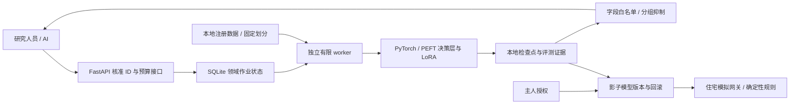

# 服务职责与执行边界

本文件维护实现职责；验收与剩余范围统一见 [acceptance.md](acceptance.md)。来源版本见 [sources.json](sources.json)。

| 原架构模块 | 代码与实际职责 | 当前边界 |
|---|---|---|
| M1 入口与作业 | `api.py`、`contracts.py`、`runtime.py`、`worker.py`：认证、配方/预算、持久排队、停止/恢复、独立 worker | 本地参考 Bearer 身份；现有 agent/session/A2A 权威不迁入本仓库 |
| M2 数据与版本 | `data.py`：注册目录、字节摘要、私密 CSV 核验及核准元数据 | API 没有任意路径或读取原始记录入口 |
| M3 整理与特征 | 全题记录 schema；真实成绩缺失/重复/父子题重叠和覆盖检查 | VLM 数字化、原图核对及真实题目连接仍待完成；不重建旧量表特征 |
| M4 划分 | 按完整时间单位留出；同组互斥；内容固定的 split ID | 训练和验证不读取最终 test IDs；真实独立/前瞻测试仍未提供 |
| M5 训练 | `training.py`：一次前向、候选决策层、真实 PEFT LoRA、监督更新及检查点 | 微型随机 Qwen3 骨干只验证执行；9B/GPU 配方尚未注册开放 |
| M6 奖励与优化 | 物理均值加权平方误差、住宅交叉熵作为监督目标 | RLCD 式更新及同预算继续监督对照尚未实现；不宣称复现厂商完整配方 |
| M7 评测与诊断 | `diagnostics.py`：MAE/分值加权 MAE/±5/10pp、分类准确率/Brier；版本与资源 | 只导出核准字段；无足够独立验证组时不制造置信区间 |
| M8 记录与产物 | SQLite 实验账本、本地检查点/哈希清单、同预算比较、影子批准与回滚 | MLflow 对接待做；账本不替代生产 agent 管理或人工业务验收 |
| M9 结果出口 | 显式 Pydantic 响应、指标/资源字段白名单、分组数量下限、通用错误码 | 原始数据、身份映射、逐条预测、权重和日志留本地；部署身份/ACL 隔离待实机验证 |

## 首批配方的可复现边界

两种 CPU 配方共享同一固定随机骨干和数据划分：只训练决策层，或决策层＋LoRA。源代码与依赖锁内容摘要进入 `code_version`；数据摘要进入固定 split，作业保存请求快照。恢复校验数据、代码、模型定义和检查点字节，恢复优化器及 RNG 状态，剩余步骤与累计时间沿用原预算。

模型只有一次骨干前向，不调用 `generate`。完整输入超过已注册长度即失败，不静默截断题目。样本标签不加入模型提示。物理只监督期望均值；住宅类别概率与行为授权分别计算。

训练失败的完整异常仅写入运行目录；API 返回稳定错误码。现有参考服务对真实数据训练保持关闭，真实配方开放前必须同时完成数据、目标设备、出口查询预算和隔离验收。

## 可复用基础与接口方向

复用 FastAPI/Pydantic、PyTorch、Transformers 和 PEFT；CSV 核验为本领域的少量专用代码。Mapika/decider 的一遍前向接口和公开监督配方已检查；当前上游默认训练入口依赖 CUDA、采用全参数更新，不能直接冒充本项目 LoRA 或均值标签配方。

未来将训练工具注册到现有 SudoCode/Nexus 能力契约，保持它们的模型身份、agent、session 与 A2A 归属。涉及产品界面时跟随 Mosswork；本仓库不复制对话/团队/会话管理前端。此方向不表示集成已经完成。
